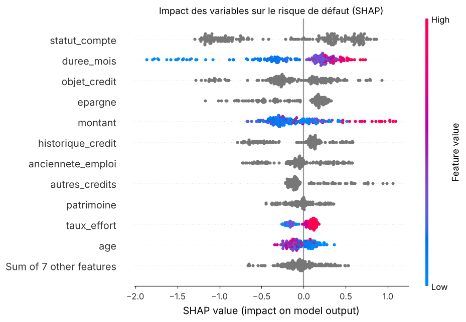
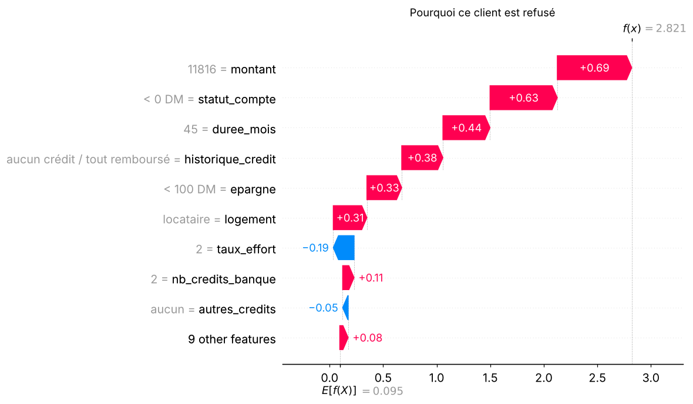

# Scoring crédit : prédire le défaut de paiement (XGBoost + SHAP)

Une banque reçoit une demande de crédit : faut-il l'accorder ?
Ce projet construit un modèle qui estime la **probabilité de défaut** d'un client, choisit un **seuil de décision qui minimise les pertes** de la banque, puis **explique chaque décision** avec SHAP.

👉 Tout est dans le notebook : [`notebooks/scoring_credit.ipynb`](notebooks/scoring_credit.ipynb)

## Résultats

Évaluation finale sur 200 clients jamais vus pendant l'entraînement :

| Stratégie | Gini | Coût moyen par dossier |
|---|---|---|
| Accepter tout le monde | – | 1,50 |
| Régression logistique (référence) | 0,61 | 0,60 |
| **XGBoost** | **0,63** | **0,54** |

- XGBoost **divise par près de 3 le coût** par rapport à « accepter tout le monde » et bat la régression logistique, le modèle historique des banques.
- Le seuil de refus optimal est d'environ **0,21** (et non 0,5), car accorder un crédit à un mauvais payeur coûte 5 fois plus que refuser un bon client.
- Les variables les plus influentes sont le **solde du compte courant**, la **durée** du crédit, son **objet**, l'**épargne** et le **montant**.

<p align="center">
  
  
</p>

*À gauche : impact global de chaque variable. À droite : pourquoi un client précis est refusé (montant élevé, compte à découvert, crédit sur 45 mois...).*

## Démarche

1. **Données** : German Credit (1 000 clients, 20 variables), codes traduits en libellés lisibles.
2. **Éthique** : retrait des variables sensibles (sexe/situation familiale, nationalité).
3. **Exploration** : taux de défaut par catégorie, distributions de la durée et du montant.
4. **Référence** : régression logistique, évaluée en validation croisée à 5 plis.
5. **XGBoost** : réglages prudents (arbres peu profonds) pour limiter le surapprentissage, classes rééquilibrées.
6. **Seuil métier** : choix du seuil qui minimise le coût (matrice 5/1), calculé en validation croisée pour ne pas tricher avec le jeu de test.
7. **Explicabilité** : SHAP global (quelles variables comptent) et local (justifier un refus individuel).

**Pourquoi le Gini ?** Le jeu est déséquilibré (30 % de défauts) : l'accuracy serait trompeuse. Le Gini (= 2 × AUC − 1) mesure la capacité à classer les clients du plus sûr au plus risqué ; c'est la métrique standard des équipes risque de crédit.

## Lancer le projet

```bash
git clone <url-de-ton-repo>
cd scoring-credit
python -m venv .venv && source .venv/bin/activate   # Windows : .venv\Scripts\activate
pip install -r requirements.txt
jupyter notebook notebooks/scoring_credit.ipynb
```

Les données sont incluses dans `data/`. Si le fichier est supprimé, il est retéléchargé automatiquement depuis l'UCI (aucun compte nécessaire).

## Structure

```
scoring-credit/
├── data/german.data.csv        # données brutes (UCI)
├── notebooks/scoring_credit.ipynb
├── src/
│   ├── data.py                 # chargement, libellés lisibles, variables sensibles
│   └── model.py                # modèles, Gini, coût métier, choix du seuil
├── reports/figures/            # graphiques générés par le notebook
└── requirements.txt
```

## Limites et pistes

- 1 000 clients des années 1990 : le projet démontre une méthode, il n'est pas destiné à la production.
- La matrice de coût 5/1 est une convention ; en pratique on la calcule à partir de la perte en cas de défaut (LGD) et de la marge.
- Retirer les variables sensibles ne garantit pas l'équité (variables corrélées) : un audit d'équité serait l'étape suivante.

**Prochaines étapes envisagées :** passer sur Home Credit (300 000 clients), optimiser les hyperparamètres avec Optuna, calibrer les probabilités (PD au sens de Bâle), construire une grille de score, déployer une démo Streamlit.

## Données

Hofmann, H. (1994). *Statlog (German Credit Data)*. UCI Machine Learning Repository. https://doi.org/10.24432/C5NC77 — licence CC BY 4.0.

## Auteur

**Issa Aziz Karambiri**, étudiant ingénieur en mathématiques appliquées (data, IA, finance).
